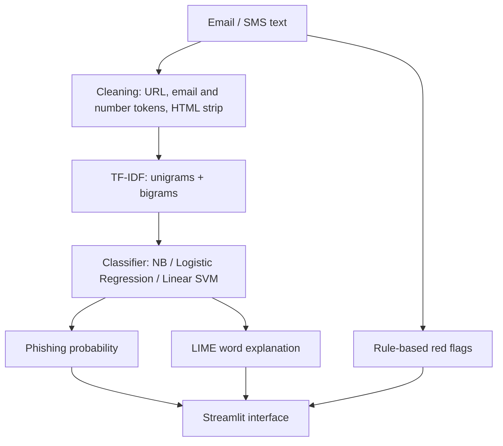

# Phishing-Detector

**Explainable phishing and spam message detection using classical NLP, TF-IDF and LIME.**


A lightweight NLP system that classifies an email or SMS as **phishing/spam** or **legitimate**, and explains *why* by highlighting the words that drove the decision. It trains in about a second on a laptop CPU and ships with an interactive web demo.

demo.png

## Features

- **End-to-end NLP pipeline:** text cleaning → TF-IDF (unigrams + bigrams) → classifier → probability.
- **Three models compared automatically:** Multinomial Naive Bayes, Logistic Regression and Linear SVM (calibrated). The best model by F1 is saved.
- **Word-level explanations (LIME):** each prediction is shown with influential words highlighted red (toward phishing) or green (toward legitimate).
- **Rule-based red flags:** raw-IP links, URL shorteners, abused TLDs, `@` in URLs, urgency language, shouting, excessive `!`.
- **Proper evaluation:** precision, recall, F1, ROC-AUC, confusion matrix, error analysis, 5-fold cross-validation, ablation study, threshold analysis, learning curve and a simple robustness test.
- **Bring your own data:** `train.py` auto-detects the text and label columns of most phishing/spam CSV files.
- **Streamlit app:** paste a message, get a verdict, confidence, red flags and highlighted evidence.

## How it works



1. **Cleaning** lowercases the text, replaces links, email addresses and numbers with placeholder tokens (`urltoken`, `emailtoken`, `numtoken`), strips HTML and punctuation.
2. **TF-IDF** turns text into sparse vectors using unigrams and bigrams, English stop-word removal, `min_df=2` and sublinear term frequency.
3. **Classifiers** are trained on an 80/20 stratified split (seed 42). Logistic Regression is preferred when it is within 0.005 F1 of the best model, because its coefficients are directly interpretable.
4. **LIME** perturbs the message by removing words, watches how the probability changes and fits a local linear model to find the most influential words.

## Results

Evaluated on the [SMS Spam Collection](https://archive.ics.uci.edu/dataset/228/sms+spam+collection) (5,169 unique messages after de-duplication, 12.6% spam), 80/20 stratified split.

| Model | Accuracy | Precision | Recall | F1 | ROC-AUC |
|---|---|---|---|---|---|
| Naive Bayes | 98.65 | 97.56 | 91.60 | 94.49 | 99.34 |
| **Logistic Regression** | 98.55 | 93.94 | 94.66 | 94.30 | 99.68 |
| Linear SVM | 98.55 | 96.77 | 91.60 | 94.12 | 99.72 |

**5-fold cross-validation (mean ± std, %)**

| Model | Accuracy | Precision | Recall | F1 |
|---|---|---|---|---|
| Naive Bayes | 98.6 ± 0.3 | 97.4 ± 1.6 | 91.1 ± 0.9 | 94.1 ± 1.1 |
| Logistic Regression | 98.0 ± 0.5 | 90.5 ± 3.9 | 94.0 ± 2.0 | 92.2 ± 2.0 |
| Linear SVM | 98.4 ± 0.3 | 94.6 ± 3.4 | 92.8 ± 2.3 | 93.6 ± 1.3 |

**Key findings**

- Always predicting "legitimate" already gives 87.4% accuracy, so accuracy alone is a poor metric here. Precision, recall and F1 on the spam class are reported instead.
- A rules-only detector reaches just 34.9% F1; the learned model reaches 94.3%.
- Ablation (F1, Logistic Regression): raw unigrams 91.9% → + text cleaning 93.2% → + bigrams 93.5% → + stop-word removal, `min_df`, sublinear TF 94.3%.
- Lowering the decision threshold trades precision for recall (for example, threshold 0.3 cuts missed spam to 4 messages at the cost of 20 false alarms).
- **Known weakness:** appending benign words to spam drops recall from 94.7% to 69.5%, which is expected for a bag-of-words model. See [Limitations](#limitations).

Results on email data depend on the dataset you train on; run the commands below to reproduce them for your own corpus.

## Project structure

```
Phishing-Detector/
├── app.py              # Streamlit web application
├── train.py            # Train, compare and evaluate the models
├── experiments.py      # CV, ablation, ROC/PR, thresholds, learning curve, robustness
├── nlp_utils.py        # Text cleaning and rule-based red-flag extraction
├── requirements.txt
├── data/               # Place dataset files here (not tracked by git)
└── model/              # Saved model, metrics.json, plots, errors.csv
```

## Installation

```bash
git clone https://github.com/YOUR-USERNAME/Phishing-Detector.git
cd Phishing-Detector

python -m venv venv
# Windows
venv\Scripts\activate
# Linux / macOS
source venv/bin/activate

pip install -r requirements.txt
```

## Usage

**1. Get a dataset** and put it in `data/`. Any CSV with a text column and a label column works, for example one of the public phishing email datasets on Kaggle (such as the "Phishing Email Dataset") or the SMS Spam Collection.

**2. Train and evaluate**

```bash
python train.py --data data/your_dataset.csv
```

This prints the metrics of all three models and saves the best one to `model/model.joblib`, together with `metrics.json`, a confusion-matrix plot, a top-features plot and `errors.csv` (misclassified test messages).

**3. (Optional) Run the extended experiments**

```bash
python experiments.py --data data/your_dataset.csv
```

Writes `model/experiments.json` plus ROC, precision-recall and learning-curve plots.

**4. Launch the demo**

```bash
streamlit run app.py
```

Open `http://localhost:8501`, choose a sample message or paste your own, and click **Analyze**.

### Supported dataset formats

The loader recognises common column names automatically, for example:

| Text column | Label column | Example labels |
|---|---|---|
| `Email Text` | `Email Type` | `Phishing Email` / `Safe Email` |
| `text_combined` | `label` | `1` / `0` |
| `body` | `label` | `1` / `0` |
| `v2` / `text` | `v1` / `label` | `spam` / `ham` |

If your file uses other names, the loader falls back to the longest text column and reports what it picked; adjust `TEXT_CANDS` / `LABEL_CANDS` in `train.py` if needed.

## Limitations

- **Text only.** Sender reputation, email headers, link destinations and attachments are not analysed.
- **Vocabulary-dependent.** A model trained on one corpus can degrade on another or on newly worded campaigns; benchmark datasets can also contain artefacts absent from real traffic.
- **Not adversarially robust.** Padding a message with benign words can lower the spam score substantially (see Results).
- **LIME is approximate** and can vary slightly between runs.
- Treat the output as decision support, not as a replacement for human judgement.

## Roadmap

- [ ] Cross-dataset evaluation (train on one corpus, test on another)
- [ ] Header and URL-reputation features
- [ ] Fine-tuned transformer (BERT) baseline and comparison of explanations
- [ ] Adversarial testing and adversarial training
- [ ] SHAP comparison and multilingual support

## Tech stack

Python · scikit-learn · pandas · NumPy · LIME · Matplotlib · joblib · Streamlit

Released under the [MIT License](LICENSE).

## Author

**Krishna** — B.Tech Computer Science (IoT & IS), Manipal University Jaipur
GitHub: [@KrishnaCS7](https://github.com/KrishnaCS7)
